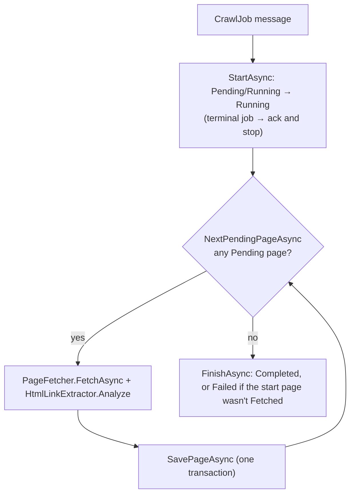

# The crawl frontier lives in the database

> Written on 2026-10-26, after the assessment window closed. It changes no code: it explains a design that is already in the code (D-13). §5, the detailed comparison with one message per page, was added on 2026-10-27. The README's "Post-assessment documentation" section lists everything added since the submission.

The phrase "the frontier is in the database" appears in the [README](../README.md), [DECISIONS.md](../DECISIONS.md) (D-13, D-24), the [reviewer guide](REVIEWER_GUIDE.md), the [developer guide](DEVELOPER_GUIDE.md) and the code comments in [`JobCrawler`](../src/Crawler.Worker/JobCrawler.cs) and [`CrawlStore`](../src/Crawler.Infrastructure/Persistence/CrawlStore.cs). This page explains what it means and why the rest of the design depends on it.

## 1. What a frontier is

In a breadth-first crawl, the **frontier** is the set of URLs that have been discovered but not yet fetched. A textbook crawler keeps it in an in-memory queue:

```
queue = [startUrl]; seen = {startUrl}
while queue not empty:
    url = queue.dequeue()
    html = fetch(url)
    for link in links(html):
        if link not in seen: seen.add(link); queue.enqueue(link)
```

That queue and the `seen` set exist only in the process. If the worker crashes, restarts, or receives the same message twice, both are lost. Nothing records what was left to do or what had already been found.

## 2. The frontier here

There is no queue object. **The frontier is the job's rows in `pages` with `status = 'Pending'`.** Each queue operation is a database operation:

| Queue operation | Database operation | Code |
|---|---|---|
| Seed with the start URL | Insert the root page (depth 0, `Pending`) in the same transaction as the job | [`JobEndpoints.CreateJob`](../src/Crawler.Api/JobEndpoints.cs) / `RootPage` |
| Peek at the next URL | `WHERE job_id = @id AND status = 'Pending' ORDER BY depth, id LIMIT 1` | [`CrawlStore.NextPendingPageAsync`](../src/Crawler.Infrastructure/Persistence/CrawlStore.cs#L45) |
| Remove it once done | Conditional update: `Pending` → `Fetched` / `Failed` / `Skipped` `WHERE status = 'Pending'` | `CrawlStore.MarkPageAsync` |
| Enqueue unseen links | Insert same-host links as `Pending` at `depth + 1` | `CrawlStore.EnqueueChildrenAsync` |
| The `seen` set | `NOT EXISTS` on `(job_id, url_hash)`, with the unique key and `ON CONFLICT DO NOTHING` as a backstop | `CrawlStore.EnqueueChildrenAsync` |
| Queue empty, so stop | The peek returns nothing; the loop exits | [`JobCrawler.RunAsync`](../src/Crawler.Worker/JobCrawler.cs#L23), then `FinishAsync` |

**Why the order is breadth-first.** Sorting by `depth` takes every depth-1 page before any depth-2 page. Within a depth, `id` (an identity column) is discovery order, so the table behaves as a FIFO queue.

**Peeking does not claim the page.** A page stays `Pending` while it is being fetched. It leaves the frontier only when its result is saved. That is what makes a crash mid-fetch safe: the page is still `Pending` and gets fetched again. It is also the source of the duplicate-fetch issue in §6.

**`seen` covers every page, not just pending ones.** The `NOT EXISTS` check looks at all of the job's pages, whatever their status. A URL that was already fetched, failed or skipped is never enqueued again.

## 3. One page, step by step



[`SavePageAsync`](../src/Crawler.Infrastructure/Persistence/CrawlStore.cs#L58) does all of this in one transaction:
1. Locks the job row (`SELECT max_pages - pages_enqueued … FOR UPDATE`) and reads how many pages the cap still allows.
2. Marks the page done with `WHERE status = 'Pending'`. If 0 rows change, another delivery already saved it, so the transaction rolls back and nothing else is written.
3. Inserts the page's outgoing edges.
4. If `depth < maxDepth` and the cap allows, inserts the new same-host children as `Pending`, up to the remaining allowance.
5. Bumps `pages_enqueued` and `pages_processed`, and commits.

Because the outcome, the new frontier entries and the counters commit together, the frontier is never left half-updated.

## 4. Why it matters

**Redelivery resumes instead of restarting.** The API publishes one message per job, `CrawlJob { jobId }`. Suppose the worker dies, or a transient database error triggers a retry (D-24, D-28, D-29), after 40 of 100 pages. When the message is redelivered, `StartAsync` leaves a `Running` job `Running` and the next peek returns page 41. No checkpoint is needed, because the database already is one.

**Duplicate deliveries are harmless.** Every write is conditional (see the idempotency table in the [reviewer guide](REVIEWER_GUIDE.md#idempotency-at-least-once-delivery)). If two deliveries race for the same page, the loser changes 0 rows and its result is discarded ("already crawled by another delivery" in the worker log).

**Completion has no race.** The original plan (D-2) sent one message per page, which would have put the frontier in the broker. Then "is the job finished?" would have needed counters shared across messages, a race over which page finishes last, and a way to finish a job whose page message was dead-lettered. With the frontier in the database, finished just means the peek found nothing. That trade is D-13, and the [reviewer guide §3.1](REVIEWER_GUIDE.md#31-messaging-and-the-unit-of-work) summarizes it. §5 compares the two designs in full.

**Progress comes for free.** `GET /api/jobs/{id}` counts the job's pages by status ([`JobEndpoints.GetJob`](../src/Crawler.Api/JobEndpoints.cs)). The `pending` count is the size of the frontier ([`JobContracts.cs`](../src/Crawler.Api/JobContracts.cs)).

## 5. Message per page vs message per job

D-2 planned one `CrawlPage` message per page. D-13 replaced it with one `CrawlJob` message per job. This section compares the two in full, for anyone weighing whether to go back.

### The two designs

- **Message per page (D-2, not built).** The API publishes a `CrawlPage` for the root. A consumer fetches that one page, saves it, and publishes a `CrawlPage` for each new child. **The frontier is the messages waiting in the broker.**
- **Message per job (D-13, built).** The API publishes one `CrawlJob { jobId }`. One consumer loops: peek at the shallowest `Pending` page, fetch it, save it, and insert its children as `Pending`. **The frontier is rows in the database** (§2), and the message only means "someone should own this job".

Most differences below follow from where the frontier lives.

### 5.1 Parallelism

- **Per page:** this is its main advantage. N consumers fetch N pages of the same job at once, so a 200-page crawl finishes roughly N times faster.
- **Per job:** pages are fetched one at a time. Different jobs still run in parallel, one consumer each, but one large job can't use spare capacity.
- **Caveat:** the crawl stays on one host, so parallel fetching means N requests at once to one site. Per page would need a per-host limit, such as a shared semaphore or a token bucket in Postgres or Redis. Without one, much of the speedup becomes 429s and bans (see [reviewer guide §5.5](REVIEWER_GUIDE.md#55-no-politeness-between-requests-medium) on politeness).

### 5.2 Knowing when a job is finished

- **Per job:** the job is done when the peek finds no `Pending` row. There is one loop, so there is nothing to race.
- **Per page:** no message knows it's the last. Each consumer must check "processed == enqueued?" after saving its page. Two consumers finishing the last pages at the same moment can both see "not done", so the job never finishes, or both mark it done.
- **Fixable, at a cost:** do the check in the same transaction that bumps `pages_processed`, while holding the job-row lock. `SavePageAsync` already takes `FOR UPDATE` on the job and updates both counters in one transaction (D-20), so this is moderate work. It is still the code, and the concurrency tests, that D-13 avoided.

### 5.3 The page cap and the depth limit

- **Per job:** one writer, so the cap is exact: `SavePageAsync` inserts children with `LIMIT remaining`.
- **Per page:** many consumers draw on the same allowance at once. That stays correct only because every save locks the job row, which then serializes all consumers of a job at the save step. Proving the cap holds under concurrency also needs its own tests.
- **Depth:** depth travels with each page, so both designs respect `maxDepth` the same way.

### 5.4 Retries and failures

- **Per page:** a page that keeps failing goes through the retry policy and the dead-letter queue on its own, and the other pages carry on. That isolation is a real strength. The catch: a dead-lettered page message leaves its page `Pending` forever, so processed never reaches enqueued and the job never finishes. You'd need a `Fault<CrawlPage>` consumer that marks the page Failed and bumps the counter exactly once, which brings back §5.2's race.
- **Per job:** ordinary page failures (HTTP errors, timeouts, non-HTML) are recorded as `Failed`/`Skipped` pages, and the crawl continues. Isolation mostly comes from the code rather than the broker. A *transient infrastructure* error, such as the database going away, makes the whole message go through retries (D-24, D-28, D-29). Thanks to the database frontier, the retry resumes at the next `Pending` page rather than starting over (§4). If the message is dead-lettered, `Fault<CrawlJob>` fails the whole job (D-7). Retries are coarse-grained, but resuming costs nothing.

### 5.5 Duplicate deliveries (delivery is at-least-once)

- **Per page:** a duplicate `CrawlPage` costs one extra fetch, and the conditional `WHERE status = 'Pending'` write throws its result away. Duplicate *child* messages are the bigger worry: one redelivered parent can republish all of its children. The unique `(job_id, url_hash)` key keeps the data correct, but duplicate messages and fetches can multiply down the tree.
- **Per job:** a duplicate `CrawlJob` running at the same time as the original is worse. Peeking doesn't claim a page, so both deliveries fetch every remaining page. The data stays correct, but the fetches double. Fix: `FOR UPDATE SKIP LOCKED` plus a lease on each page ([reviewer guide §5.1](REVIEWER_GUIDE.md#51-concurrent-duplicate-deliveries-both-fetch-every-page-medium)).

### 5.6 Long jobs and the ack timeout

- **Per page:** each message is held for seconds, so RabbitMQ's 30-minute delivery-acknowledgement timeout never applies.
- **Per job:** one message is held for the whole crawl. A crawl longer than 30 minutes is redelivered mid-crawl, so it resumes but briefly overlaps with itself (§5.5). Fix: process a bounded batch, publish a continuation `CrawlJob`, then ack ([reviewer guide §5.2](REVIEWER_GUIDE.md#52-long-jobs-and-the-delivery-ack-timeout-medium)).

### 5.7 Crawl order

- **Per job:** strict breadth-first in `(depth, id)` order (§2). The tree's parent links are deterministic, and `JobCrawlerTests` asserts the exact request sequence.
- **Per page:** order depends on queue timing and which consumer is free. Depth limits still hold, but a page reachable from two parents gets whichever parent saved first. Tests would have to assert sets of pages rather than sequences.

### 5.8 Fairness between jobs

- **Per page:** pages from every job share one queue. A 200-page job puts 200 messages ahead of a 1-page job submitted just after it, unless you add per-job queues or priorities.
- **Per job:** each job holds one consumer. With K consumers, job K+1 waits behind K slow sites.

### 5.9 Broker load and observability

- **Per page:** about one message per page (up to 200 per job, plus duplicates). Queue depth shows the total backlog, but one job's progress still needs the database.
- **Per job:** one message per job. Progress is a `GROUP BY status` over the job's pages (D-26), and the `pending` count is the frontier itself (§4).

### 5.10 Cost to build and test

This decided it under the timebox. Per page needed cross-message counters, completion under concurrency, a page-level fault consumer, and tests for all three. D-13 estimated switching saved about 30 minutes. Switching before slices 2–3 also meant no per-page code was built and then thrown away. The idempotent page schema served both designs, so nothing was lost.

### Summary

| | Message per page | Message per job (built) |
|---|---|---|
| Speed of one job | Parallel, but needs per-host rate limiting | One page at a time |
| Completion | Needs a locked counter check; racy otherwise | Peek finds no `Pending` row |
| Page cap | Concurrent consumers share one allowance, serialized on the job row | Exact, single writer |
| Failure isolation | Per page via the DLQ, plus a fault consumer to unstick the job | Per page in code; infrastructure failures retry and resume, or fail the job |
| Duplicate cost | One page, but child messages can fan out | Every remaining page, until fetches are claimed |
| Ack timeout | Not an issue | Needs batch plus continuation for long crawls |
| Order | Not deterministic | Strict breadth-first |
| Complexity | High | Low |

### The middle path

Neither extreme is the best next step. Keep the frontier in the database and add a **bounded worker pool** over it. Workers claim pages with `FOR UPDATE SKIP LOCKED` and a lease (an expired lease returns the page to the frontier), the job processes a batch, publishes a continuation `CrawlJob` and acks. That gives per-page parallelism, isolation from duplicates, and short message holds, while keeping completion as "no `Pending` rows" and the cap as a single locked allowance. The rows in §6 are the steps.

Message per page wins outright only when the units of work are independent. A crawl's pages aren't: each page creates the next ones, and they all draw on a shared cap and depth limit. That shared, growing state is what a database transaction handles well and what a broker doesn't.

## 6. Costs and what would come next

| Cost | Fix | Reference |
|---|---|---|
| No parallelism within a job: one consumer crawls one page at a time | A bounded worker pool over the same frontier, which needs claiming (next row) | [Reviewer guide §4](REVIEWER_GUIDE.md#4-whats-missing), item 9 |
| Peeking doesn't claim, so two concurrent deliveries of one job both fetch every remaining page (results stay correct) | `SELECT … FOR UPDATE SKIP LOCKED` plus a `Claimed` status and a lease; pages with an expired lease go back to the frontier | [Reviewer guide §5.1](REVIEWER_GUIDE.md#51-concurrent-duplicate-deliveries-both-fetch-every-page-medium) |
| One message is held for the whole crawl, so a very long crawl can pass RabbitMQ's 30-minute ack timeout | Process a bounded batch of pages, publish a continuation `CrawlJob`, then ack. The database frontier is what makes this safe. | [Reviewer guide §5.2](REVIEWER_GUIDE.md#52-long-jobs-and-the-delivery-ack-timeout-medium) |
| No index serves the peek query, so each step scans the job's pages: O(pages²) per job | Partial index `(job_id, depth, id) WHERE status = 'Pending'` | [Reviewer guide §5.8](REVIEWER_GUIDE.md#58-frontier-query-has-no-supporting-index-low) |

## 7. Inspecting it

The frontier query from the [developer guide §2.4](DEVELOPER_GUIDE.md#24-postgresql):

```sql
SELECT id, depth, url FROM pages WHERE job_id = '<id>' AND status = 'Pending' ORDER BY depth, id LIMIT 20;
```

- **Pending rows and the job `Running`, but nothing moving:** the worker is paused in a debugger, or the message was dead-lettered while the database was down. See the "Job stuck Running" row in [developer guide §5.6](DEVELOPER_GUIDE.md#56-common-worker-problems).
- **No Pending rows but the job is still `Running`:** the worker is between its last save and `FinishAsync`, or it stopped there. A redelivery finishes the job, because the peek returns nothing straight away.
- **A job is done when no Pending pages remain**, not when `pages_processed` equals `pages_enqueued`.
