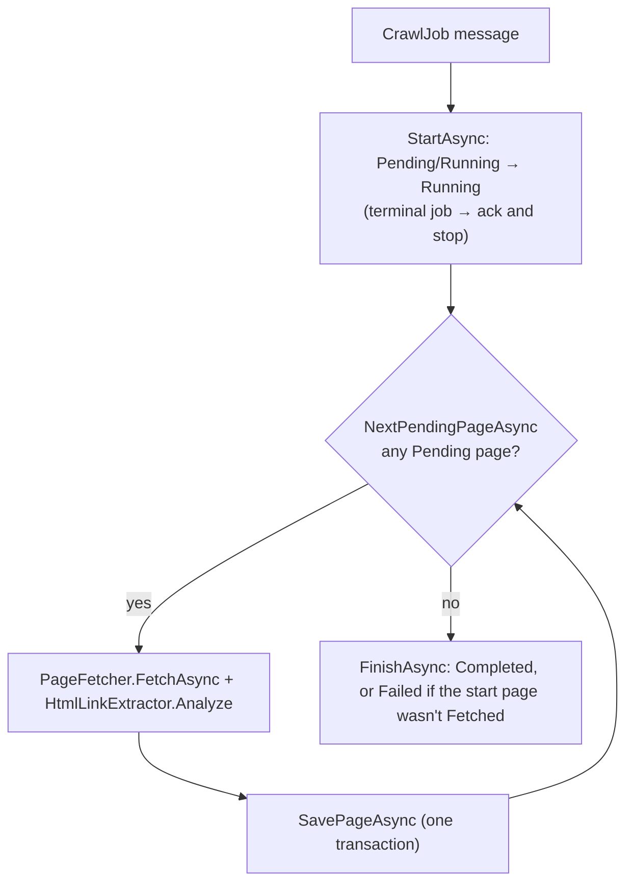

# The crawl frontier lives in the database

> Written on 2026-10-26, after the assessment window closed. It changes no code: it explains a design that is already in the code (D-13). The README's "Post-assessment documentation" section lists everything added since the submission.

The phrase "the frontier is in the database" appears in the [README](../README.md), [DECISIONS.md](../DECISIONS.md) (D-13, D-24), the [reviewer guide](REVIEWER_GUIDE.md), the [developer guide](DEVELOPER_GUIDE.md) and the code comments in [`JobCrawler`](../src/Crawler.Worker/JobCrawler.cs) and [`CrawlStore`](../src/Crawler.Infrastructure/Persistence/CrawlStore.cs). This page explains what it means and why the rest of the design depends on it.

## 1. What a frontier is

In a breadth-first crawl, the **frontier** is the set of URLs that have been discovered but not yet fetched. A textbook crawler keeps it in an in-memory queue:

```
queue = [startUrl]; seen = {startUrl}
while queue not empty:
    url = queue.dequeue()
    html = fetch(url)
    for link in links(html):
        if link not in seen: seen.add(link); queue.enqueue(link)
```

That queue and the `seen` set exist only in the process. If the worker crashes, restarts, or receives the same message twice, both are lost. Nothing records what was left to do or what had already been found.

## 2. The frontier here

There is no queue object. **The frontier is the job's rows in `pages` with `status = 'Pending'`.** Each queue operation is a database operation:

| Queue operation | Database operation | Code |
|---|---|---|
| Seed with the start URL | Insert the root page (depth 0, `Pending`) in the same transaction as the job | [`JobEndpoints.CreateJob`](../src/Crawler.Api/JobEndpoints.cs) / `RootPage` |
| Peek at the next URL | `WHERE job_id = @id AND status = 'Pending' ORDER BY depth, id LIMIT 1` | [`CrawlStore.NextPendingPageAsync`](../src/Crawler.Infrastructure/Persistence/CrawlStore.cs#L45) |
| Remove it once done | Conditional update: `Pending` → `Fetched` / `Failed` / `Skipped` `WHERE status = 'Pending'` | `CrawlStore.MarkPageAsync` |
| Enqueue unseen links | Insert same-host links as `Pending` at `depth + 1` | `CrawlStore.EnqueueChildrenAsync` |
| The `seen` set | `NOT EXISTS` on `(job_id, url_hash)`, with the unique key and `ON CONFLICT DO NOTHING` as a backstop | `CrawlStore.EnqueueChildrenAsync` |
| Queue empty, so stop | The peek returns nothing; the loop exits | [`JobCrawler.RunAsync`](../src/Crawler.Worker/JobCrawler.cs#L23), then `FinishAsync` |

**Why the order is breadth-first.** Sorting by `depth` takes every depth-1 page before any depth-2 page. Within a depth, `id` (an identity column) is discovery order, so the table behaves as a FIFO queue.

**Peeking does not claim the page.** A page stays `Pending` while it is being fetched. It leaves the frontier only when its result is saved. That is what makes a crash mid-fetch safe: the page is still `Pending` and gets fetched again. It is also the source of the duplicate-fetch issue in §5.

**`seen` covers every page, not just pending ones.** The `NOT EXISTS` check looks at all of the job's pages, whatever their status. A URL that was already fetched, failed or skipped is never enqueued again.

## 3. One page, step by step



[`SavePageAsync`](../src/Crawler.Infrastructure/Persistence/CrawlStore.cs#L58) does all of this in one transaction:
1. Locks the job row (`SELECT max_pages - pages_enqueued … FOR UPDATE`) and reads how many pages the cap still allows.
2. Marks the page done with `WHERE status = 'Pending'`. If 0 rows change, another delivery already saved it, so the transaction rolls back and nothing else is written.
3. Inserts the page's outgoing edges.
4. If `depth < maxDepth` and the cap allows, inserts the new same-host children as `Pending`, up to the remaining allowance.
5. Bumps `pages_enqueued` and `pages_processed`, and commits.

Because the outcome, the new frontier entries and the counters commit together, the frontier is never left half-updated.

## 4. Why it matters

**Redelivery resumes instead of restarting.** The API publishes one message per job, `CrawlJob { jobId }`. Suppose the worker dies, or a transient database error triggers a retry (D-24, D-28, D-29), after 40 of 100 pages. When the message is redelivered, `StartAsync` leaves a `Running` job `Running` and the next peek returns page 41. No checkpoint is needed, because the database already is one.

**Duplicate deliveries are harmless.** Every write is conditional (see the idempotency table in the [reviewer guide](REVIEWER_GUIDE.md#idempotency-at-least-once-delivery)). If two deliveries race for the same page, the loser changes 0 rows and its result is discarded ("already crawled by another delivery" in the worker log).

**Completion has no race.** The original plan (D-2) sent one message per page, which would have put the frontier in the broker. Then "is the job finished?" would have needed counters shared across messages, a race over which page finishes last, and a way to finish a job whose page message was dead-lettered. With the frontier in the database, finished just means the peek found nothing. That trade is D-13, and the [reviewer guide §3.1](REVIEWER_GUIDE.md#31-messaging-and-the-unit-of-work) describes it.

**Progress comes for free.** `GET /api/jobs/{id}` counts the job's pages by status ([`JobEndpoints.GetJob`](../src/Crawler.Api/JobEndpoints.cs)). The `pending` count is the size of the frontier ([`JobContracts.cs`](../src/Crawler.Api/JobContracts.cs)).

## 5. Costs and what would come next

| Cost | Fix | Reference |
|---|---|---|
| No parallelism within a job: one consumer crawls one page at a time | A bounded worker pool over the same frontier, which needs claiming (next row) | [Reviewer guide §4](REVIEWER_GUIDE.md#4-whats-missing), item 9 |
| Peeking doesn't claim, so two concurrent deliveries of one job both fetch every remaining page (results stay correct) | `SELECT … FOR UPDATE SKIP LOCKED` plus a `Claimed` status and a lease; pages with an expired lease go back to the frontier | [§5.1](REVIEWER_GUIDE.md#51-concurrent-duplicate-deliveries-both-fetch-every-page-medium) |
| One message is held for the whole crawl, so a very long crawl can pass RabbitMQ's 30-minute ack timeout | Process a bounded batch of pages, publish a continuation `CrawlJob`, then ack. The database frontier is what makes this safe. | [§5.2](REVIEWER_GUIDE.md#52-long-jobs-and-the-delivery-ack-timeout-medium) |
| No index serves the peek query, so each step scans the job's pages: O(pages²) per job | Partial index `(job_id, depth, id) WHERE status = 'Pending'` | [§5.8](REVIEWER_GUIDE.md#58-frontier-query-has-no-supporting-index-low) |

## 6. Inspecting it

The frontier query from the [developer guide §2.4](DEVELOPER_GUIDE.md#24-postgresql):

```sql
SELECT id, depth, url FROM pages WHERE job_id = '<id>' AND status = 'Pending' ORDER BY depth, id LIMIT 20;
```

- **Pending rows and the job `Running`, but nothing moving:** the worker is paused in a debugger, or the message was dead-lettered while the database was down. See the "Job stuck Running" row in [developer guide §5.6](DEVELOPER_GUIDE.md#56-common-worker-problems).
- **No Pending rows but the job is still `Running`:** the worker is between its last save and `FinishAsync`, or it stopped there. A redelivery finishes the job, because the peek returns nothing straight away.
- **A job is done when no Pending pages remain**, not when `pages_processed` equals `pages_enqueued`.
